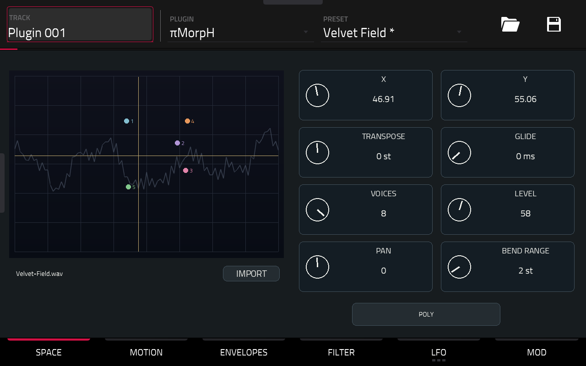

# πMorpH

A polyphonic XY wavetable synthesizer for Akai Force Gen1.

Pick a sound. Play a note. Let its timbre travel.

## Play

Each voice moves through a wavetable space using a path and an elliptical orbit. Shape it with independent amplitude/filter envelopes, a high-pass → low-pass filter pair, two LFOs and eight modulation routes.

- Up to eight voices, POLY / MONO / LEGATO and glide.
- Editable paths with 2–12 points; fixed, one-shot, loop and ping-pong playback.
- Tempo-synced path/orbit timing and dual LFOs with eleven shapes, with a live dot on each LFO curve.
- **Arpeggiator**: 20 modes, tempo-locked rate, latch, octaves, gate, chance.
- **FX**: tape delay (*Dub Station*) into reverb (*Tidal Verb*, 10 types), saved with presets and projects.
- Native touch controls, contextual Q-Links and compact selection panels.
- Light graphical previews: live XY cross and coloured path points, a smooth filter curve.
- **100 original multi-frame wavetable sounds + INIT**, in the native PRESET menu.
- **Custom Wavetable**: import your own WAV tables from the device drives.
- Native preset/project state, including musical parameters and the selected table or external file path.

## Download

πMorpH **0.2.0** — [release v0.2.0](https://github.com/timomacquis/piMorpH-MPC/releases/tag/v0.2.0):

| Device generation | Download |
| --- | --- |
| **Gen1 / Force** (ARM32) and **Gen2** (ARM64, not tested on hardware) | [piMorpH-0.2.0-mpc-sdk.zip](https://github.com/timomacquis/piMorpH-MPC/releases/download/v0.2.0/piMorpH-0.2.0-mpc-sdk.zip) |

Unzip, copy the folder **`Timo - VST - πMorpH`** into **`VST2 Plugins`** at the root of a drive (User Memory: `/sdcard/VST2 Plugins`), then restart MPC. This is the installation method defined by Akai's plugin SDK: no installer script, no `Synths` folder, no MPC.settings entry. Requires MPC OS 3.10.1+ with Enhancements and External Plugin Support enabled. See [Installation and removal](docs/INSTALLATION.md).

[Français](docs/MODE-EMPLOI.md) · [English](docs/USER-MANUAL.md) · [Build](docs/BUILD.md) · [Validation](docs/VALIDATION.md).

## Custom Wavetable

In **SPACE**, press **IMPORT** and browse **DISKS** or **USER**.

1. Tap a WAV: **VALID** appears in green after validation, without changing the current sound.
2. Tap the same file again: **LOADING** appears in green, then the panel closes.
3. Shape the sound and save it through the native PRESET menu.

| WAV encoding | Channels | Samples per waveform | Waveforms per table |
|---|---|---|---|
| PCM 16-bit | Mono or stereo | 512 / 1024 / 2048 | 1–256 with consistent cycle metadata |
| PCM 32-bit | Mono or stereo | 512 / 1024 / 2048 | 1–256 with consistent cycle metadata |
| Float 32-bit | Mono or stereo | 512 / 1024 / 2048 | 1–256 with consistent cycle metadata |

Metadata-free 256-waveform exports are detected by length; other unambiguous layouts are accepted. Valid cycle metadata takes precedence, including 64 × 2048 tables. Stereo is averaged to mono and levels are normalized in memory. The WAV sample-rate field does not set oscillator pitch; 44.1 and 48 kHz files are supported without audio resampling.

**The original WAV is never modified.** Presets and projects retain its absolute path: keep the file at that location. Invalid or silent files produce a red **ERROR :** message and leave the current table active. [Details](docs/IMPORT.md).

The factory bank remains **100 sounds + INIT**, with Velvet Field first. Keep the 0.1.0 package for projects that reference its former Adventure Kid table filenames.

## Status

Force Gen1 / ARM32. 0.2.0 adds the arpeggiator, the delay/reverb page and the live LFO dot; 0.1.x projects and presets reopen with the same sound (new features start off). The build was installed and used on the device. PC tests cover the engine, arpeggiator, effects, import, saved state and native programs. This does not claim exhaustive device qualification or Gen2 compatibility.

## Sources and licensing

GPL-3.0-or-later for the instrument. Original factory wavetables included with redistribution permission. Full credits and component licenses: [THIRD-PARTY.md](THIRD-PARTY.md). No ROM or commercial instrument factory-bank extractions are included.
