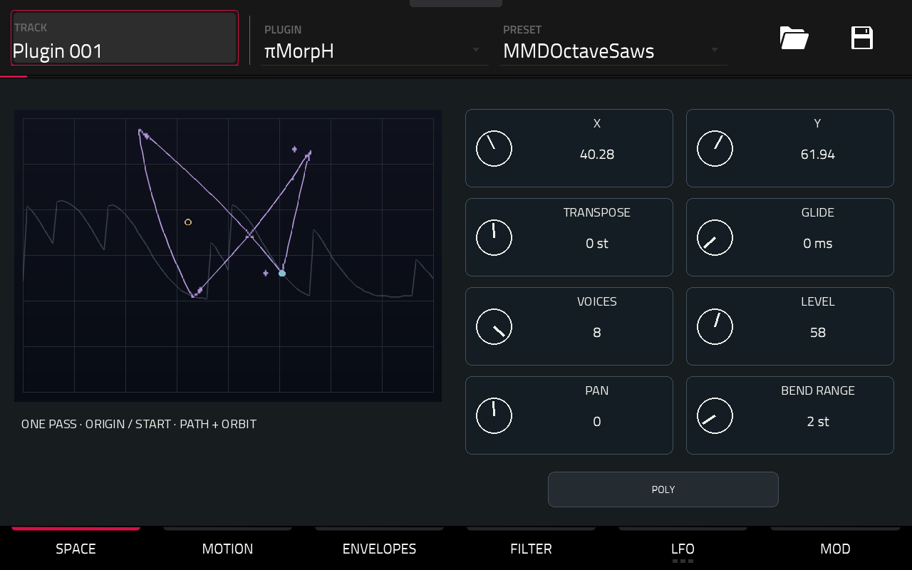

# πMorpH

A polyphonic XY wavetable synthesizer for Akai Force Gen1.

Pick a sound. Play a note. Let its timbre travel.

## Play

Each voice moves through a wavetable space using a path and an elliptical orbit. Shape it with independent amplitude/filter envelopes, a high-pass → low-pass filter pair, two LFOs and eight modulation routes.

- Up to eight voices, POLY / MONO / LEGATO and glide.
- Editable paths with 2–12 points; fixed, one-shot, loop and ping-pong playback.
- Tempo-synced path/orbit timing and dual LFOs with eleven shapes.
- Native touch controls, contextual Q-Links and compact selection panels.
- Cached graphical previews, with background updates held during editing.
- **100 original multi-frame wavetable sounds + INIT**, in the native PRESET menu.
- **Custom Wavetable**: import your own WAV tables from the device drives.
- Native preset/project state, including musical parameters and the selected table or external file path.

## Download

[πMorpH 0.1.2 — Force Gen1 / ARMv7](https://github.com/timomacquis/piMorpH-MPC/releases/tag/v0.1.2)

Package: **piMorpH-0.1.2-mpc-armv7.zip**. Use the included standard installer after saving your project. No Gen2 package is provided.

[Français](docs/MODE-EMPLOI.md) · [English](docs/USER-MANUAL.md) · [Build](docs/BUILD.md) · [Validation](docs/VALIDATION.md).

## Custom Wavetable

In **SPACE**, press **IMPORT** and browse **DISKS** or **USER**.

1. Tap a WAV: **VALID** appears in green after validation, without changing the current sound.
2. Tap the same file again: **LOADING** appears in green, then the panel closes.
3. Shape the sound and save it through the native PRESET menu.

| WAV encoding | Channels | Samples per waveform | Waveforms per table |
|---|---|---|---|
| PCM 16-bit | Mono or stereo | 512 / 1024 / 2048 | 1–256 with consistent cycle metadata |
| PCM 32-bit | Mono or stereo | 512 / 1024 / 2048 | 1–256 with consistent cycle metadata |
| Float 32-bit | Mono or stereo | 512 / 1024 / 2048 | 1–256 with consistent cycle metadata |

Metadata-free 256-waveform exports are detected by length; other unambiguous layouts are accepted. Valid cycle metadata takes precedence, including 64 × 2048 tables. Stereo is averaged to mono and levels are normalized in memory. The WAV sample-rate field does not set oscillator pitch; 44.1 and 48 kHz files are supported without audio resampling.

**The original WAV is never modified.** Presets and projects retain its absolute path: keep the file at that location. Invalid or silent files produce a red **ERROR :** message and leave the current table active. [Details](docs/IMPORT.md).

The factory bank remains **100 sounds + INIT**, with Velvet Field first. Keep the 0.1.0 package for projects that reference its former Adventure Kid table filenames.

## Status

Force Gen1 / ARM32. The installed 0.1.2 candidate was validated on the device; this release retains its exact engine, skin and factory bank. PC tests cover accepted import formats, two-tap selection, saved VST state, failure fallback, native programs and graphics notification limits. This does not claim exhaustive device qualification or Gen2 compatibility.

## Sources and licensing

GPL-3.0-or-later for the instrument. Original factory wavetables included with redistribution permission. Full credits and component licenses: [THIRD-PARTY.md](THIRD-PARTY.md). No ROM or commercial instrument factory-bank extractions are included.
