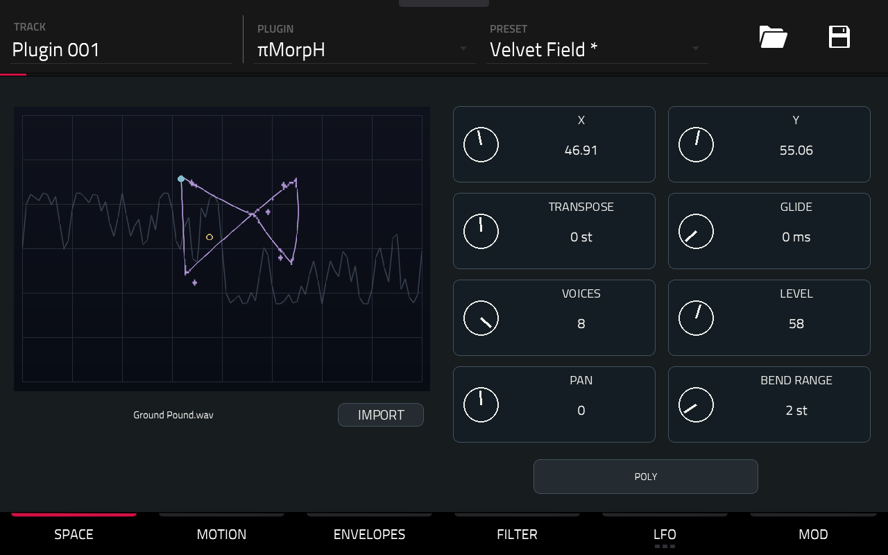
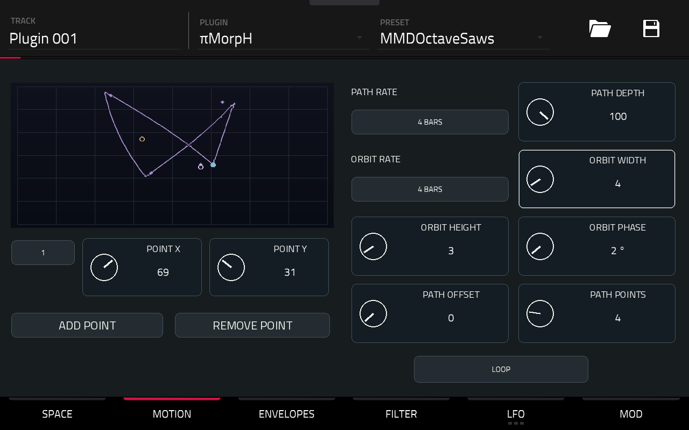
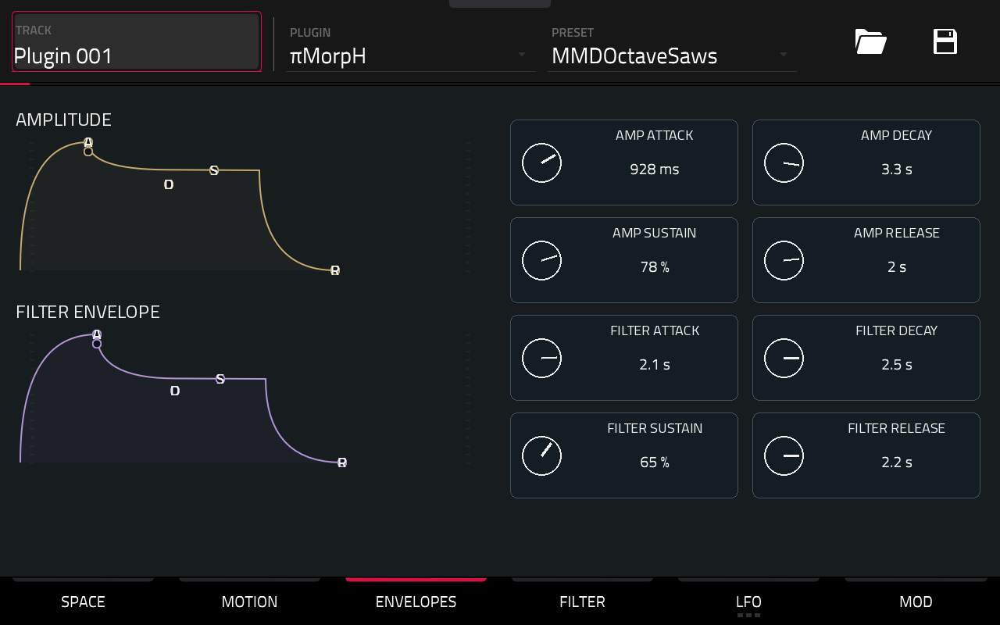
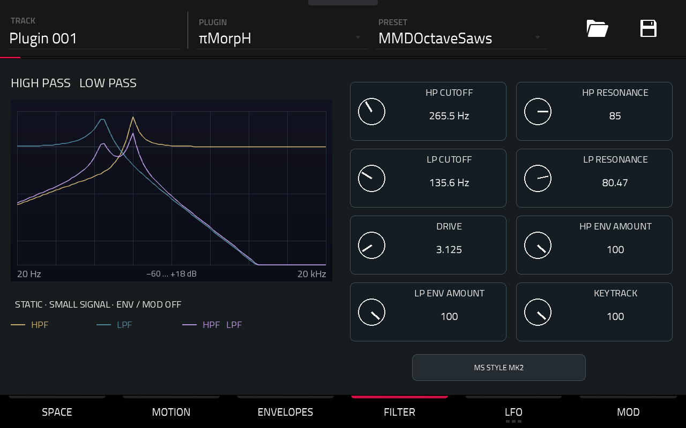
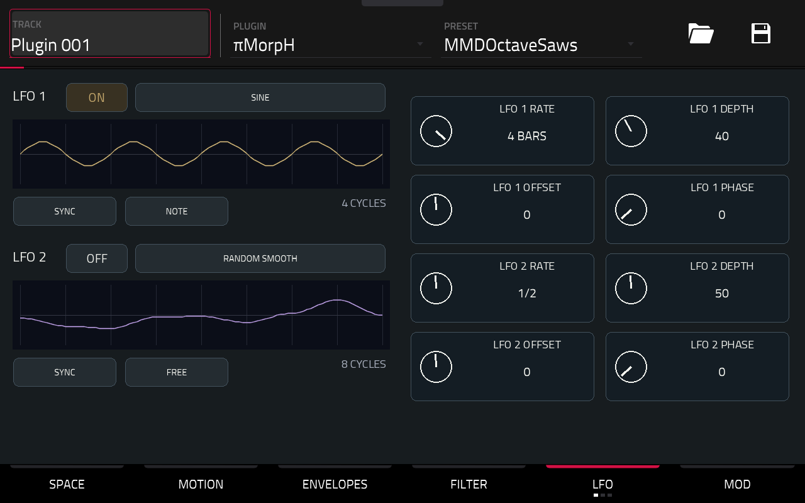
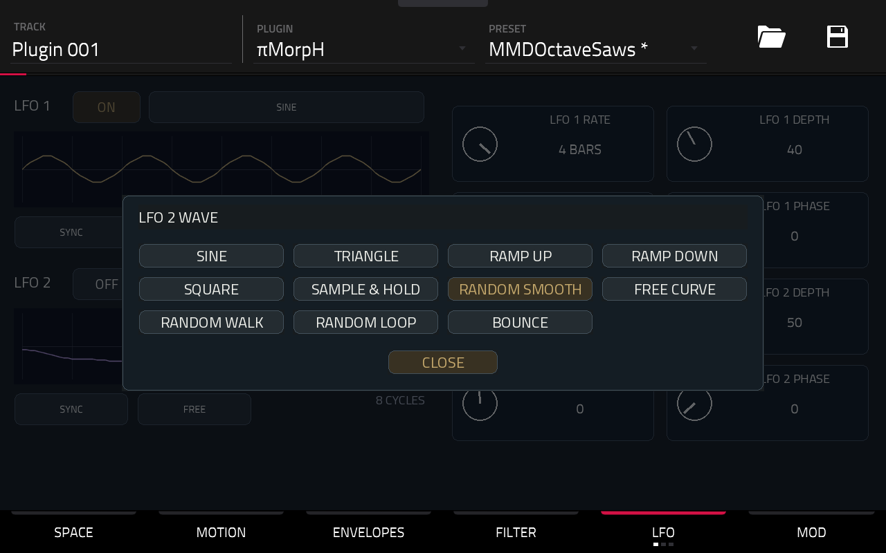
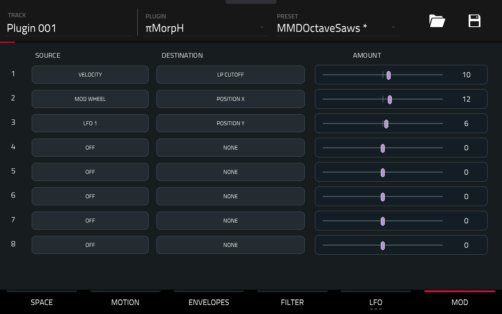

# πMorpH — Mode d’emploi

[English](USER-MANUAL.md)

Choisis un son. Joue une note. Fais voyager son timbre.

**πMorpH est un synthétiseur polyphonique à tables d’ondes.** Chaque voix explore un espace XY, suit un trajet et une orbite, puis traverse deux filtres. Enveloppes et LFO donnent vie à l’ensemble.

Ce guide décrit la version **0.1.1, Force Gen1 / ARM32**, avec **100 sons paramétrés + INIT**.

## 1. Premier voyage

Charge πMorpH sur une piste Plugin.

Ouvre **PRESET**, en haut à droite, et choisis un son. Les familles proposées vont des basses aux nappes, plucks, leads, textures et claviers. **INIT**, en fin de liste, offre un départ simple.

Joue les pads ou lance une séquence de notes. Pour entendre évoluer une nappe, maintiens un accord.

Commence par **X / Y** dans SPACE. Passe ensuite à MOTION pour mettre le timbre en mouvement.

Les sélecteurs ouvrent un panneau compact. Le choix actif est doré ; **CLOSE** ferme le panneau sans changer le choix. Le sélecteur d’ouverture devient jaune pendant l’ouverture, parfois derrière le panneau.

Touche un réglage puis tourne la molette, ou utilise les Q-Links affectés à la page.

## 2. SPACE — Choisir son terrain

Les captures montrent le skin sur la Force avant le changement de banque ; les noms de presets affichés appartiennent à la banque privée précédente.

**X / Y** placent l’origine dans la table. Entre les positions, les formes d’ondes se mélangent progressivement.

Le dessin aide à se repérer :

- **Violet** : un passage du trajet avec son orbite.
- **Gris** : l’onde à la position XY choisie.
- **Doré** : l’origine XY.
- **Azur** : le départ du parcours représenté, pas un suivi des notes jouées.

Pendant une manipulation, le repère d’origine bouge sans reconstruire tout le dessin. Après l’arrêt, **Processing…** accompagne brièvement sa préparation, puis le nouveau tracé apparaît complet.

**TRANSPOSE** change le registre, de −24 à +24 demi-tons.

**GLIDE** fait glisser la hauteur entre les notes lorsqu’une voix est réutilisée. Essaie-le en MONO ou LEGATO.

**VOICES** limite la polyphonie à 1–8 voix. **LEVEL** règle le volume ; **PAN**, le panoramique ; **BEND RANGE**, l’étendue du pitch bend.

Le bouton du bas choisit le jeu :

- **POLY** : accords, jusqu’au nombre de voix choisi.
- **MONO** : une voix, enveloppes redéclenchées.
- **LEGATO** : une voix ; les notes liées gardent les enveloppes et le mouvement en cours.

## 3. MOTION — Dessiner le voyage

Le déplacement commence avec chaque nouvelle voix. Sa durée suit le tempo de la Force.

Le bouton du bas choisit le parcours :

- **FIXED** : pas de trajet ; l’orbite peut encore agir.
- **ONE SHOT** : un aller, puis maintien au dernier point.
- **LOOP** : retour au départ à chaque tour.
- **PING-PONG** : aller et retour en sens inverse.

**PATH RATE** règle la durée d’un aller : de **1/16 à 4 BARS**. En PING-PONG, le retour prend la même durée.

**PATH DEPTH** dose l’écart du trajet autour de XY. À zéro, le trajet ne déplace plus le son. **PATH OFFSET** décale son point de départ dans le parcours.

Une orbite elliptique s’ajoute au trajet :

**ORBIT RATE** règle sa période.

**ORBIT WIDTH / HEIGHT** règlent sa largeur et sa hauteur. Mets les deux à zéro pour la retirer.

**ORBIT PHASE** décale son départ.

Pour construire le trajet, ouvre le sélecteur numéroté, choisis un point et ajuste **POINT X / Y**. **ADD POINT / REMOVE POINT** modifient leur nombre ; **PATH POINTS** le règle directement, entre **2 et 12**.

Les positions restent dans les limites de l’espace XY. Le dessin montre un aperçu du parcours, pas les huit voix en temps réel.

## 4. ENVELOPES — Sculpter la note

Deux enveloppes indépendantes par voix.

**AMPLITUDE** façonne le volume.

**FILTER ENVELOPE** anime les coupures, selon les quantités réglées dans FILTER.

Pour chacune :

- **ATTACK** : temps pour atteindre le maximum.
- **DECAY** : temps pour rejoindre le niveau de sustain.
- **SUSTAIN** : niveau tenu tant que la note reste appuyée.
- **RELEASE** : relâchement après la fin de la note.

Pour un pluck : attaque courte, sustain bas, decay court.

Pour une nappe : attaque et release plus longs.

Les courbes servent de repères de réglage ; leur dessin n’est pas une mesure audio de l’enveloppe.

## 5. FILTER — Ouvrir, creuser, faire résonner

Le son traverse **HP → LP** : passe-haut, puis passe-bas.

**HP CUTOFF** retire le grave ; **LP CUTOFF** referme l’aigu. Les deux **RESONANCE** accentuent la zone de coupure.

**DRIVE** pousse l’entrée des filtres.

**HP ENV AMOUNT / LP ENV AMOUNT** appliquent l’enveloppe de filtre. Une valeur négative inverse son action.

**KEYTRACK** fait suivre les coupures à la hauteur des notes.

Le bouton du bas propose **BYPASS**, **MS STYLE MK1** et **MS STYLE MK2**. En BYPASS, la chaîne de filtres et son drive sont contournés.

Les courbes séparent **HPF doré**, **LPF bleu** et **réponse combinée violette**. C’est une réponse statique autour du silence : elle ne représente pas les variations dues aux enveloppes, aux modulations ou à la saturation.

## 6. LFO — Ajouter du mouvement

Deux LFO, à connecter dans MOD. **ON** devient doré lorsqu’un LFO est actif.

Choisis la forme :

**SINE, TRIANGLE, RAMP UP, RAMP DOWN, SQUARE** pour les mouvements réguliers.

**SAMPLE & HOLD, RANDOM SMOOTH, RANDOM WALK, RANDOM LOOP** pour le hasard, par paliers ou plus souple.

**FREE CURVE** pour une courbe personnalisée ; **BOUNCE** pour les rebonds.

**HZ / SYNC** choisit une vitesse libre ou une division synchronisée au tempo.

**RATE** règle la vitesse. **DEPTH** dose le signal du LFO ; **OFFSET** le décale ; **PHASE** déplace son départ.

**FREE** laisse tourner le LFO. En SYNC/FREE, il suit la position du transport.

**NOTE** redémarre sa phase à chaque nouvelle note déclenchée ; les notes liées en LEGATO ne le redéclenchent pas. Les LFO sont partagés par les voix.

L’aperçu montre **4 cycles** pour les formes régulières, **8 cycles** pour les formes aléatoires. Il décrit le signal, pas une tête de lecture animée.

Les sous-pages **LFO 1 SHAPE / LFO 2 SHAPE**, accessibles depuis la navigation LFO, donnent les réglages particuliers et les huit points de FREE CURVE : largeur du carré, pas de RANDOM WALK, longueur/évolution de RANDOM LOOP, gravité/rebond de BOUNCE.

**Un LFO allumé sans routage dans MOD ne change pas le son.**

## 7. MOD — Relier les idées

Huit lignes : **SOURCE → DESTINATION → AMOUNT**.

Choisis une source, une destination, puis déplace le slider. Une quantité négative inverse l’action. **AMOUNT 0**, **SOURCE OFF** ou **DESTINATION NONE** neutralise la ligne.

Sources : **LFO 1/2, AMP ENV, FILTER ENV, VELOCITY, NOTE, MOD WHEEL, PRESSURE**.

Destinations : **POSITION X/Y, PATH RATE, ORBIT RATE/WIDTH/HEIGHT, PITCH, HP/LP CUTOFF, HP/LP RESONANCE, AMPLITUDE, PAN**.

Essaie :

**LFO 1 → POSITION Y → 6** pour un mouvement discret.

**VELOCITY → LP CUTOFF → 10** pour ouvrir le son avec le jeu.

**MOD WHEEL → POSITION X → 12** pour explorer le timbre à la molette de modulation.

Les lignes visant la même destination s’additionnent. AMOUNT est une profondeur de modulation, pas une valeur directe en Hz ou en demi-tons.

## 8. Garder ses découvertes

Le menu **PRESET** contient **100 sons différenciés + INIT**, construits à partir des 100 tables fournies. Velvet Field est le premier preset, avec les réglages sauvegardés sur la Force. Chaque son possède ses propres réglages.

Utilise la sauvegarde native de la Force pour conserver un preset ou ton projet. La table choisie et les réglages musicaux sont mémorisés ensemble.

Le format et la restitution des états sont testés sur PC. Le cycle complet de sauvegarde/réouverture de cette nouvelle banque par le menu natif reste à confirmer sur la Force.

**Pour repartir simplement : charge INIT, joue une note et explore X / Y.**
