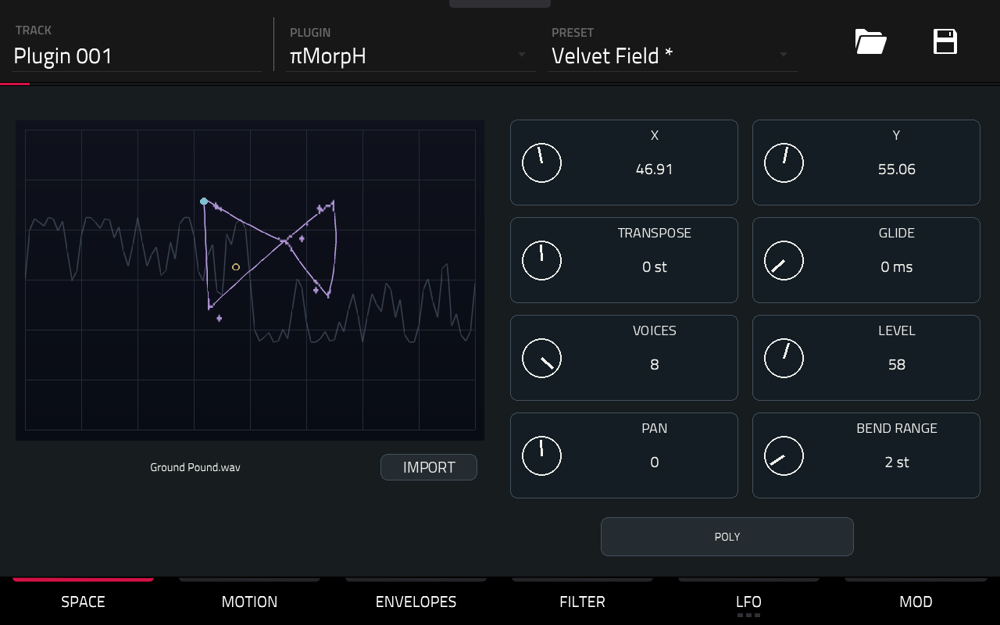
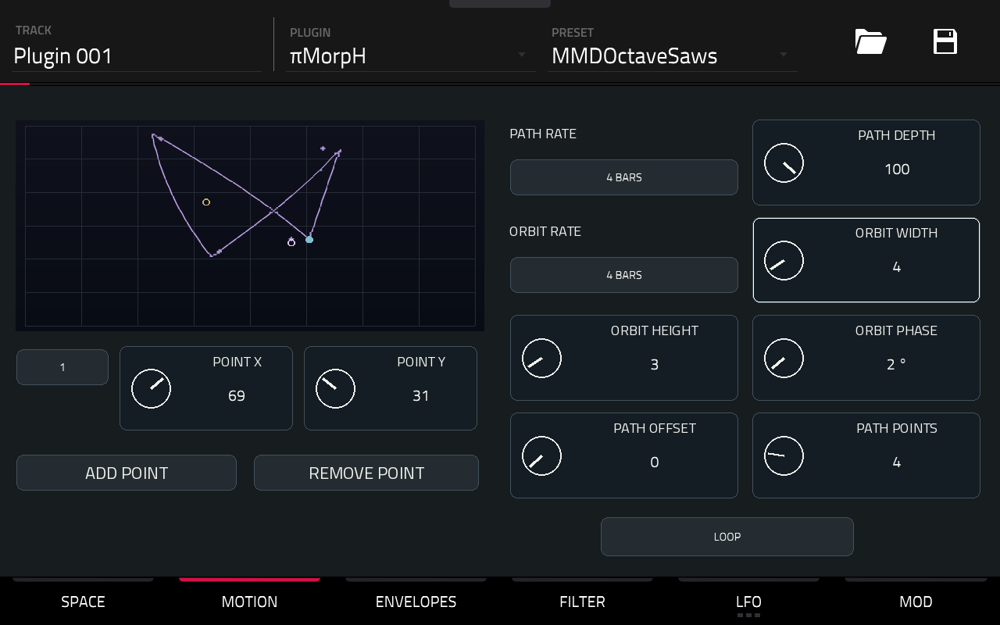
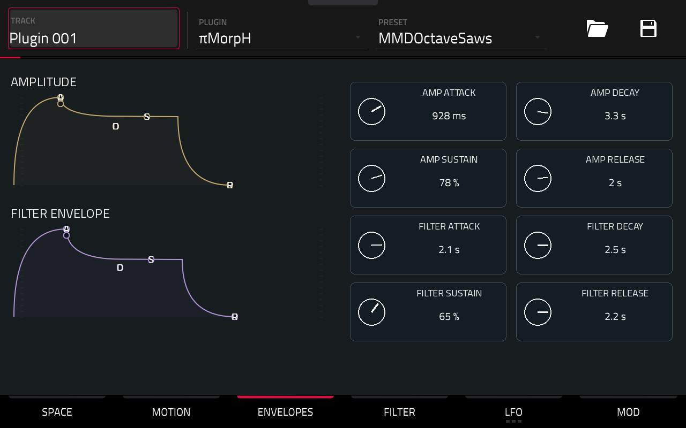
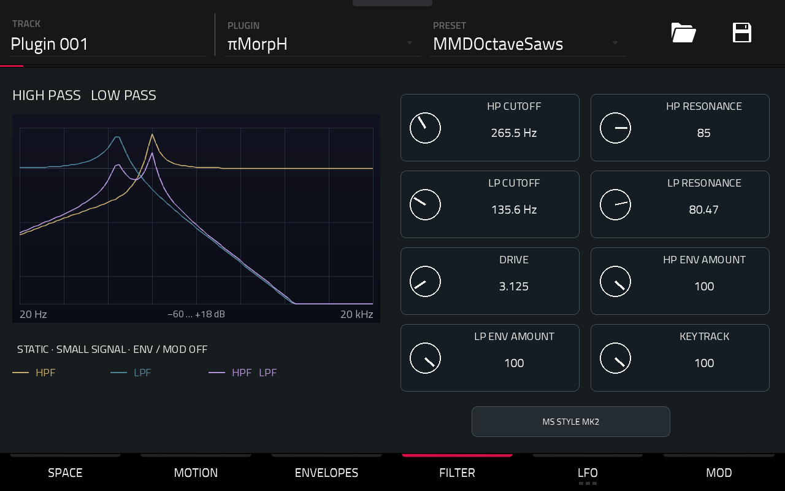
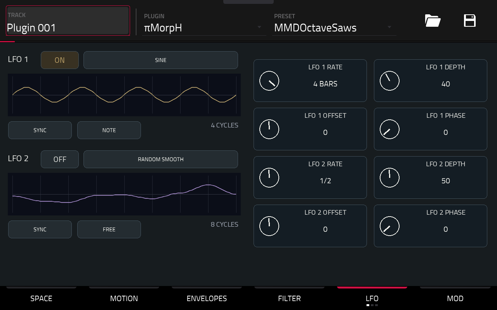
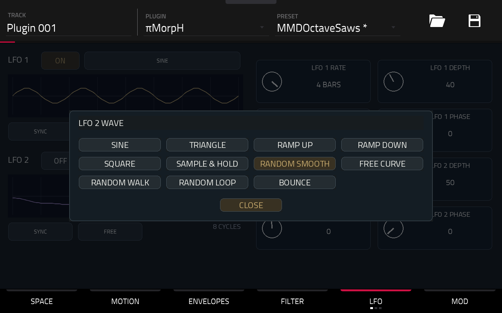
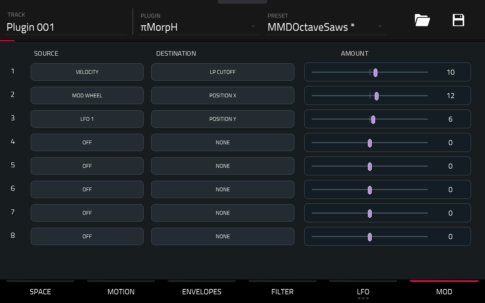

# πMorpH — User Manual

[Français](MODE-EMPLOI.md)

Pick a sound. Play a note. Let its timbre travel.

**πMorpH is a polyphonic wavetable synthesizer.** Each voice explores an XY space, follows a path and an orbit, then passes through two filters. Envelopes and LFOs bring it to life.

This guide describes the **0.1.2 candidate, Force Gen1 / ARM32** release with **100 shaped sounds + INIT**.

## 1. Your first journey

Load πMorpH on a Plugin track.

Open **PRESET** at the top right and choose a sound. The bank covers basses, pads, plucks, leads, textures and keys. **INIT**, at the end of the list, offers a simple starting point.

Play the pads or start a note sequence. Hold a chord to hear a pad evolve.

Start with **X / Y** in SPACE. Then visit MOTION to set the timbre in motion.

Selectors open compact panels. The current choice is gold; **CLOSE** dismisses the panel without changing it. The opening selector turns yellow while its panel is open, sometimes behind the panel itself.

Touch a control and turn the data wheel, or use the Q-Links assigned to the page.

## 2. SPACE — Choose your terrain

Screenshots show the skin on Force before the bank change; displayed preset names belong to the earlier private bank.

**X / Y** place the origin in the table. Between positions, the waveforms blend smoothly.

Read the drawing as a map:

- **Violet**: one pass through the path, including its orbit.
- **Grey**: the waveform at the selected XY position.
- **Gold**: the XY origin.
- **Azure**: the start of the displayed journey, not a live note indicator.

While you adjust a control, the origin marker moves without rebuilding the entire drawing. After you stop, **Processing…** briefly accompanies its preparation, then the complete new drawing appears.

**TRANSPOSE** shifts the register by −24 to +24 semitones.

**GLIDE** slides pitch between notes when a voice is reused. Try it in MONO or LEGATO.

**VOICES** limits polyphony to 1–8 voices. **LEVEL** sets volume; **PAN** sets stereo position; **BEND RANGE** sets the pitch-bend range.

The bottom button chooses the playing mode:

- **POLY**: chords, up to the selected voice limit.
- **MONO**: one voice, with envelopes retriggered.
- **LEGATO**: one voice; overlapping notes keep the envelopes and movement running.

### Import your own table

In **SPACE**, press **IMPORT**, then choose a WAV from **DISKS** or **USER**. First tap validates without changing the sound: **VALID in green**. Tap the same file again: **LOADING in green**, then the panel closes. Errors appear in red with **ERROR :** and leave the current table active.

**1–256 waveforms** with consistent cycle metadata, each containing **512, 1024 or 2048 samples**. **PCM16, PCM32 or float32 WAV**, mono or stereo.

Cycle size is detected automatically. Stereo is averaged to mono and the table is normalized in memory. The WAV sample-rate field does not change oscillator pitch.

Your sound settings remain. If import fails, the current table stays loaded.

Presets and projects store **the WAV path**: keep it at that location. The original file is never modified.

## 3. MOTION — Draw the journey

Movement starts with each newly triggered voice. Its timing follows the Force tempo.

The bottom button chooses how the path plays:

- **FIXED**: no path movement; the orbit can still act.
- **ONE SHOT**: travel to the last point, then stay there.
- **LOOP**: return to the start on each repeat.
- **PING-PONG**: travel forwards, then backwards.

**PATH RATE** sets the duration of one forward journey, from **1/16 to 4 BARS**. In PING-PONG, the return takes the same time.

**PATH DEPTH** controls the path displacement around XY. At zero, the path no longer moves the sound. **PATH OFFSET** shifts the starting position along the path.

An elliptical orbit is added to the path:

**ORBIT RATE** sets its period.

**ORBIT WIDTH / HEIGHT** set its width and height. Set both to zero to remove it.

**ORBIT PHASE** shifts its starting phase.

To build a path, open the numbered selector, choose a point and adjust **POINT X / Y**. **ADD POINT / REMOVE POINT** change the number of points; **PATH POINTS** sets it directly, from **2 to 12**.

Positions stay within the XY space. The drawing previews the journey; it does not track all eight voices in real time.

## 4. ENVELOPES — Shape the note

Two independent envelopes per voice.

**AMPLITUDE** shapes volume.

**FILTER ENVELOPE** moves the cutoffs, according to the amounts set in FILTER.

For each envelope:

- **ATTACK**: time to reach the maximum.
- **DECAY**: time to reach the sustain level.
- **SUSTAIN**: level held while the note remains down.
- **RELEASE**: fade after the note ends.

For a pluck: short attack, low sustain, short decay.

For a pad: longer attack and release.

The curves are control guides, not audio measurements of the envelopes.

## 5. FILTER — Open, carve, resonate

The sound passes through **HP → LP**: high-pass, then low-pass.

**HP CUTOFF** removes low frequencies; **LP CUTOFF** closes down the highs. Each **RESONANCE** emphasizes the cutoff region.

**DRIVE** pushes the filter input.

**HP ENV AMOUNT / LP ENV AMOUNT** apply the filter envelope. Negative values reverse its action.

**KEYTRACK** makes the cutoffs follow note pitch.

The bottom button offers **BYPASS**, **MS STYLE MK1** and **MS STYLE MK2**. BYPASS skips the filter chain and its drive.

The curves show **gold HPF**, **blue LPF** and **violet combined response**. This is a static response around silence: it does not show changes caused by envelopes, modulation or saturation.

## 6. LFO — Add movement

Two LFOs, ready to connect in MOD. **ON** turns gold when an LFO is active.

Choose a shape:

**SINE, TRIANGLE, RAMP UP, RAMP DOWN, SQUARE** for regular movement.

**SAMPLE & HOLD, RANDOM SMOOTH, RANDOM WALK, RANDOM LOOP** for stepped or smoother random motion.

**FREE CURVE** for a custom curve; **BOUNCE** for bouncing motion.

**HZ / SYNC** selects a free-running speed or a tempo-synced division.

**RATE** sets speed. **DEPTH** scales the LFO signal; **OFFSET** shifts it; **PHASE** shifts its starting phase.

**FREE** lets the LFO keep running. In SYNC/FREE, it follows the transport position.

**NOTE** restarts its phase on each newly triggered note; overlapping LEGATO notes do not retrigger it. The LFOs are shared by the voices.

The preview shows **4 cycles** for regular shapes and **8 cycles** for random shapes. It illustrates the signal rather than an animated playback position.

The **LFO 1 SHAPE / LFO 2 SHAPE** subpages, available through LFO navigation, provide shape-specific settings and the eight FREE CURVE points: square width, RANDOM WALK step size, RANDOM LOOP length/evolution, and BOUNCE gravity/restitution.

**An enabled LFO without a MOD routing does not change the sound.**

## 7. MOD — Connect your ideas

Eight rows: **SOURCE → DESTINATION → AMOUNT**.

Choose a source and destination, then move the slider. A negative amount reverses the action. **AMOUNT 0**, **SOURCE OFF** or **DESTINATION NONE** neutralizes the row.

Sources: **LFO 1/2, AMP ENV, FILTER ENV, VELOCITY, NOTE, MOD WHEEL, PRESSURE**.

Destinations: **POSITION X/Y, PATH RATE, ORBIT RATE/WIDTH/HEIGHT, PITCH, HP/LP CUTOFF, HP/LP RESONANCE, AMPLITUDE, PAN**.

Try:

**LFO 1 → POSITION Y → 6** for subtle movement.

**VELOCITY → LP CUTOFF → 10** to open the sound as you play harder.

**MOD WHEEL → POSITION X → 12** to explore the timbre with the modulation wheel.

Rows targeting the same destination add together. AMOUNT is a modulation depth, not a direct value in Hz or semitones.

## 8. Keep your discoveries

The **PRESET** menu contains **100 shaped sounds + INIT**, built from the 100 supplied tables. Velvet Field is preset 1, using the settings saved on the Force. Each sound has its own settings.

Use the Force’s native save functions to keep a preset or your project. The selected table and musical settings are stored together.

State storage and restoration are tested on PC. A full save/reopen cycle for this new bank through the native menu still needs confirmation on the Force.

**For a fresh start: load INIT, play a note and explore X / Y.**
